# ARHITEKTURA — kurskc.hr (KURS Liga)

> Pogled iz ptičje perspektive za AI sesije. Cilj: razumjeti kako se **plugin** (podaci + domenska logika + admin) i **tema** (renderiranje) povezuju, bez čitanja cijelog koda.
>
> **Upozorenje:** datoteka `CLAUDE.md` u korijenu repozitorija je **zastarjela i mjestimično netočna** (spominje CPT-ove `momcad`/`utakmica` i taksonomije `liga`/`sezona` koji NE postoje, te CSS varijable `--color-primary`/`--color-accent` kojih nema). Ovaj dokument odražava stvarni kod. Kod neusklađenosti — vjeruj ARHITEKTURA.md, ne CLAUDE.md.

---

## 1. Dvije komponente, jasna granica odgovornosti

Sustav su **dvije odvojene komponente** koje surađuju preko zajedničkog sloja podataka (WP postovi + custom DB tablice):

| Komponenta | Putanja | Odgovornost |
|---|---|---|
| **Plugin `kurs-liga`** | `app/public/wp-content/plugins/kurs-liga/` | **Podaci + logika + admin.** Custom DB tablice (`wp_kurs_*`), CPT-ovi `kurs_ekipa`/`kurs_igrac`, domenske klase (`Kurs_Season`, `Kurs_Match`, `Kurs_Playoff`), cijelo WP-admin sučelje za unos (klasa `Kurs_Admin` + viewovi), prezentacijski helperi (`includes/helpers.php`). |
| **Tema `kurskc`** | `app/public/wp-content/themes/kurskc/` | **Renderiranje (front-end).** Naslovnica, liga hub, centar utakmice, profili ekipe/igrača, vijesti. CPT `vijest` + taksonomija `vijest_kategorija`. Čita podatke kroz domenske metode plugina **i** direktnim `$wpdb` upitima na plugin tablice. |

**Granica:** plugin je **izvor istine** (write path = admin, read API = statičke metode). Tema je **isključivo prezentacija** i ne piše ligaške podatke; samo ih čita i prikazuje. Tema **funkcionalno ovisi o pluginu** — bez aktivnog plugina front-end lige ispisuje "plugin nije aktivan" (guard `class_exists('Kurs_Season')`).

```mermaid
graph TB
    subgraph Plugin["PLUGIN kurs-liga  (podaci + logika + admin)"]
        BOOT["kurs-liga.php<br/>bootstrap / konstante / hookovi"]
        DB["Kurs_Database<br/>shema, dbDelta, maybe_upgrade"]
        CPT["Kurs_CPT<br/>kurs_ekipa, kurs_igrac"]
        SEASON["Kurs_Season<br/>seasons→divisions→phases→groups→teams→squads"]
        MATCH["Kurs_Match<br/>matches, events, get_standings, get_top_scorers"]
        PLAYOFF["Kurs_Playoff<br/>bracket, seeding, advance_winner"]
        HELP["helpers.php<br/>kurs_team_badge_html / color"]
        ADMIN["Kurs_Admin<br/>menu, POST forme, AJAX"]
        VIEWS["admin/views/*.php<br/>dashboard, season-setup, matches,<br/>teams, match-record, playoff"]
    end

    subgraph Data["SLOJ PODATAKA"]
        TBL[("wp_kurs_* tablice<br/>9 custom tablica")]
        POSTS[("wp_posts + wp_postmeta<br/>kurs_ekipa, kurs_igrac, vijest")]
    end

    subgraph Theme["TEMA kurskc  (renderiranje)"]
        FUNC["functions.php<br/>setup, auto-stranice, helperi"]
        ENQ["inc/enqueue.php · inc/post-types.php"]
        HEAD["header.php (ticker) / footer.php"]
        FRONT["front-page.php · index.php"]
        LIGA["page-liga.php<br/>LIGA HUB: tablica/raspored/statistika"]
        UTAK["page-utakmica.php"]
        SINGLE["single-kurs_ekipa.php<br/>single-kurs_igrac.php"]
    end

    BOOT --> DB & CPT & SEASON & MATCH & PLAYOFF & HELP
    ADMIN --> VIEWS
    ADMIN --> SEASON & MATCH & PLAYOFF
    DB -.kreira.-> TBL
    CPT -.registrira.-> POSTS
    SEASON --> TBL
    MATCH --> TBL
    PLAYOFF --> TBL
    VIEWS --> HELP

    FUNC -. require_once .-> HELP
    LIGA --> MATCH & SEASON
    LIGA -.direktan $wpdb.-> TBL
    UTAK --> MATCH & SEASON
    SINGLE --> MATCH & SEASON
    SINGLE -.direktan $wpdb.-> TBL
    HEAD -.direktan $wpdb.-> TBL
    LIGA --> POSTS
    SINGLE --> POSTS
```



---

## 2. Ključne ulazne točke

### `kurs-liga.php` (bootstrap plugina)
Definira konstante: `KURS_VERSION='1.0.0'`, `KURS_DIR`, `KURS_URL`, `KURS_PREFIX='kurs_'`. Učitava (`require_once`) sve domenske klase i helpere, te u adminu `admin/class-admin.php`. Instancira `new Kurs_CPT()` (registrira CPT-ove na `init`). Veže:
- `add_action('plugins_loaded', ['Kurs_Database','maybe_upgrade'])` — migracija sheme na svakom učitavanju.
- `register_activation_hook` — `Kurs_Database::install()` (kreira tablice) + registracija CPT-ova + `flush_rewrite_rules()`.
- `init` 99 — jednokratni flush rewrite pravila (opcija `kurs_flush_needed`); `init` 100 — samoizlječenje: regenerira pravila ako u `rewrite_rules` nema `ekipe/…`.
- U adminu: `new Kurs_Admin()` (veže `admin_menu`, `admin_enqueue_scripts`, `admin_init`, `wp_ajax_*`).

### `functions.php` (bootstrap teme)
Konstante `KURSKC_VERSION='1.0.4'`, `KURSKC_DIR`, `KURSKC_URI`. Učitava `inc/post-types.php`, `inc/enqueue.php`, `inc/nav-menus.php`. **Ključno za spregu:** uvjetno `require_once WP_PLUGIN_DIR.'/kurs-liga/includes/helpers.php'` (ako funkcija `kurs_team_badge_html` ne postoji) — tema posuđuje prezentacijske helpere iz plugina. Automatski kreira WP stranice i dodjeljuje im Page Template metu (`_wp_page_template`): `kc-liga` + `pan-ljetna` → `page-liga.php`, `utakmica` → `page-utakmica.php`, `o-kurs-u` → `page-o-nama.php`. Skriva native "Objave"/"Komentari" iz admina; redirecta `edit.php` na `post_type=vijest`.

### `page-liga.php` (Liga Hub — glavni front-end ekran)
Template Name **"Liga Hub"**, dijeli se između stranica `/kc-liga/` i `/pan-ljetna/` (razlika po slugu: `$is_pan = (get_post_field('post_name') === 'pan-ljetna')`). Guard `class_exists('Kurs_Season')`. Kontekst se bira **isključivo GET parametrima** (nema ACF/meta): `?season_id`, `?division_id`, `?tab=tablica|raspored|statistika`. Svi tabovi/filteri rade **server-side reloadom** (`<a href>` + `<select onchange=location.href>`) — `main.js` radi samo mobilni meni i search overlay.

---

## 3. Domenski model (sažeto)

Hijerarhija natjecanja živi u **custom tablicama** (`$wpdb->prefix . KURS_PREFIX . '<ime>'` = `wp_kurs_*`); ekipe i igrači su **WP postovi** referencirani preko ID-a.

```
season (sezona: league, name, year, status)
 └─ division (divizija: "Glavna", "Liga bez briga")
     └─ phase (faza: type = 'group' | 'playoff')
         └─ group (grupa A/B…, atribut playoff_spots = koliko prolazi dalje)
             ├─ group_teams ──► kurs_ekipa  (WP post)
             └─ matches (utakmice grupne faze)
                 └─ match_events (goal | own_goal | yellow_card | red_card)
                                  └─ player_id ──► kurs_igrac (WP post)

squads        ──► visi o division_id (roster: igrač × ekipa × divizija, jersey_no)
playoff_matches ──► visi o division_id (round qf|sf|final|3rd, slot, labeli A1/QF1-W, match_id→matches)
```

**9 custom tablica:** `seasons, divisions, phases, groups, group_teams, squads, matches, match_events, playoff_matches`. Strukturni `id` su `INT UNSIGNED`; stupci koji drže WP post ID (`team_id, player_id, home_team_id, away_team_id, scored_for`) su `BIGINT UNSIGNED` = `wp_posts.ID`.

**Veza s WP-om:** `team_id → kurs_ekipa` post, `player_id → kurs_igrac` post. WP post nosi **naziv** (`post_title`), **logo** (featured image) i **boju** (postmeta `_kurs_team_color`); custom tablice nose natjecateljske podatke. Relacije **nisu** DB FOREIGN KEY — integritet se održava u aplikacijskom kodu.

**Verzioniranje:** `Kurs_Database::DB_VERSION='1.5'` (opcija `kurs_db_version`); migracije u `maybe_upgrade()` na `plugins_loaded`. Napomena: plugin header Version je `1.0.0` (drugačija shema od DB verzije).

### Tablica poretka (`Kurs_Match::get_standings($group_id)`)
Računa se **dinamički** iz `finished` utakmica (nije perzistirana). Bodovanje: pobjeda 3 / remi 1 / poraz 0. Sortiranje **UEFA/HNS model**: 1. ukupni Pts → 2–4. **head-to-head mini-tablica** izjednačenih ekipa (h2h Pts→GD→GF) → 5. ukupni GD → 6. ukupni GF → 7. fair-play (FP = žuti×3 + crveni×10, niži = bolji). Strijelci: `Kurs_Match::get_top_scorers($division_id, $limit)`.

### Playoff (`Kurs_Playoff`)
`generate($division_id)` uzima top `playoff_spots` ekipa iz svake grupe (preko `get_standings`), gradi seeding parove (`build_seeding_pairs`, predefinirane matrice 4×2, 2×2, 4×1 + generic), kreira bracket runde (qf→sf→final). `advance_winner` automatski gura pobjednika u sljedeći slot (neriješeno NE napreduje). Playoff meč se može lazy povezati sa zapisnikom (`ensure_match_record()` kreira red u `matches` s `group_id=0` kao playoff marker).

---

## 4. Tok podataka: od unosa rezultata u adminu do prikaza tablice poretka

Ovo je centralni tok koji povezuje obje komponente. Izvor istine za rezultat su **eventi** (golovi), a `home_score`/`away_score` su denormalizirani snapshot.


**Sažeto, korak po korak:**
1. **Unos** — `admin/views/match-record.php` → JS `admin.js` → AJAX `kurs_record_add_event` → `Kurs_Admin::ajax_record_add_event` → `Kurs_Match::add_event()` → INSERT u `wp_kurs_match_events`. Live rezultat računa `Kurs_Admin::compute_score()` (goal=+1 svojoj ekipi, own_goal=+1 protivniku, kartoni ne utječu).
2. **Zaključenje** — POST forma `finish_match` → `Kurs_Admin::do_finish_match` → `Kurs_Match::finish(id, home, away)` → UPDATE `wp_kurs_matches` (`status='finished'`, score snapshot). Ako je meč povezan s playoffom, sinkronizira se i playoff zapis.
3. **Prikaz** — posjetitelj otvori `page-liga.php?tab=tablica` → tema zove `Kurs_Match::get_standings($group_id)` koji čita `finished` utakmice + kartone iz `match_events`, izračuna i sortira tablicu, vrati niz. Tema renderira `.standings`, badge ekipe preko `kurs_team_badge_html()` (iz plugin `helpers.php`), boja označava playoff cutoff (`$i < playoff_spots`).

> **Write path** je uvijek admin (`Kurs_Admin` → domenske klase). **Read path** je tema (domenske metode + direktni `$wpdb`). Tema nikad ne piše.

---

## 5. Workflow operatera (end-to-end, admin)

1. **Sezona** — `kurs-seasons` → `create_season` (liga, naziv, godina) → redirect na setup.
2. **Format** — `kurs-season-setup` (step 2): divizije → faze (tip `group`) → grupe (AJAX `kurs_add_group`) → `playoff_spots` po grupi.
3. **Dodjela ekipa** — step 3: kreiraj ekipe (AJAX `kurs_create_team` = `wp_insert_post(kurs_ekipa)` + meta `_kurs_team_color`), rasporedi u grupe (`kurs_assign_team`).
4. **Roster** — `kurs-teams → Uredi` ili skrivena `kurs-roster`: igrači (`kurs_igrac` postovi) u squad po diviziji.
5. **Utakmice** — `kurs-matches`: generiraj raspored "svaka sa svakom" (AJAX `kurs_generate_fixtures`, circle-method round-robin u admin sloju) ili ručno (`add_match`).
6. **Zapisnik** — `kurs-match-record`: eventi + `finish_match` (vidi tok gore). PDF preko `?format=pdf` (browser print-to-PDF).
7. **Playoff** — `kurs-matches?playoff_div=...`: `generate_playoff` iz ljestvica, unos rezultata, `advance_winner`.

Sigurnost admina: capability `manage_options` svuda; POST forme imaju vlastiti `check_admin_referer` + PRG (`wp_safe_redirect`+`exit`); svi AJAX dijele jedan nonce `kurs_ajax` (`check_ajax_referer('kurs_ajax','nonce')`).

---

## 6. Front-end točke prikaza (tema)

| Datoteka | Ekran | Glavni izvori podataka |
|---|---|---|
| `front-page.php` | Naslovnica | vijesti (`get_posts`), statične liga kartice |
| `page-liga.php` | **Liga Hub** | `Kurs_Season::get_phases/get_groups`, `Kurs_Match::get_standings/get_top_scorers` + direktni `$wpdb` (raspored, disciplina) |
| `page-utakmica.php` | Centar utakmice (`?match_id=`) | `Kurs_Match::get/get_events`, `Kurs_Season::get_squad` + `$wpdb` kontekst |
| `single-kurs_ekipa.php` | Profil ekipe | `Kurs_Season::get_team_contexts/get_squad`, `Kurs_Match::get_standings` + `$wpdb` (forma, sve utakmice) |
| `single-kurs_igrac.php` | Profil igrača | isključivo direktni `$wpdb` (karijera) |
| `header.php` | Ticker rezultata | direktan `$wpdb` na `kurs_matches/groups/phases/divisions` (samo ako `class_exists('Kurs_Match')`) |

**Helperi za prikaz** (plugin `includes/helpers.php`, dijele plugin i tema): `kurs_team_badge_html()` (avatar/inicijali), `kurs_team_color()` (meta `_kurs_team_color`, default `#1a3a6b`), `kurs_team_text_color()` (WCAG luminancija). Relativno vrijeme `kurs_time_ago()` je u temi (`functions.php`).

**CSS varijable** (stvarne, u `assets/css/main.css`): brend `--c-kc #DA0F1E` (KC liga), `--c-pan #F47B16` (Pan ljetna), `--c-gold #FDE206`; `--c-win/--c-draw/--c-loss`. (Ne postoje `--color-primary`/`--color-accent` iz CLAUDE.md.)

> Front-end **miješa pristup**: dio podataka preko domenskih metoda plugina, dio preko ad-hoc `$wpdb` SQL-a u predlošcima (prefiks `$wpdb->prefix.'kurs_'`). Promjena sheme tablica zato zahtijeva izmjene i u pluginu i u više template datoteka.

---

## 7. Gotchas / mrtvi kod (za buduće sesije)

> ⚠️ Dio dolje navedenih grešaka **ISPRAVLJEN je 2026-06-22** — vidi [`ISPRAVCI.md`](ISPRAVCI.md). Ispravljeno je označeno s ✅.

- ✅ **CLAUDE.md ažuriran** — ranije je bio zastario (spominjao CPT-ove `momcad`/`utakmica`, taksonomije `liga`/`sezona`, boje `--color-primary`/`--color-accent`); sada točno opisuje `kurs_ekipa`/`kurs_igrac` (plugin), `vijest` + `vijest_kategorija` (tema) i boje `--c-*`.
- **Round-robin i `compute_score` su u admin sloju** (`Kurs_Admin`), ne u domenskim klasama — slabija separacija; logika scoringa duplicirana izvan domene.
- ✅ **`maybe_upgrade()` više ne koristi `ADD COLUMN IF NOT EXISTS`** (ISPRAVCI #1) — nove stupce dodaje `dbDelta` preko `install()`; ostao samo valjani `MODIFY` za `seasons.league`.
- **Stranica `kurs-playoff` nije registrirana** u `menus()` iako postoje `pg_playoff()` i `playoff.php` — mrtav kod; funkcionalni playoff je samo kroz `kurs-matches?playoff_div=`. Bracket prikaz je dupliciran u `matches.php` i `playoff.php`. ✅ Jedini živi link na nju (iz `season-setup.php`) je repointan na funkcionalnu rutu (ISPRAVCI #6).
- **Mrtvi stupac** `match_events.scored_for` (nigdje se ne piše/čita). **Mrtva grana** round `3rd` (utakmica za 3. mjesto se nigdje ne generira). *(Namjerno ostavljeno — vidi ISPRAVCI.)*
- **Rute teme:** ✅ footer više ne linka na nepostojeći `/liga/` nego na `/kc-liga/` i `/pan-ljetna/` (ISPRAVCI #7), usklađeno s headerom. I dalje: stranice `kontakt` i pravne stranice se ne kreiraju automatski → 404 ako nisu ručno dodane; breadcrumb u `page-utakmica.php` uvijek vodi na `/kc-liga/` (hardkodiran slug, krivo za Pan ljetne).
- **`reopen()` razlika je namjerna:** `Kurs_Match::reopen()` NE briše score (operater zadržava uneseni rezultat pri otključavanju; `get_standings()` ionako broji samo `status='finished'`), dok `Kurs_Playoff::reopen_match()` ga postavlja na NULL.
- **Registrirani nav izbornici** (`primary`/`footer`) i `the_custom_logo()` se ne koriste — navigacija i logo su hardkodirani.
- ✅ **`match-record-pdf.php` ispravljen** (ISPRAVCI #2–4): `$disp_home/$disp_away/$is_finished` računaju se prije PDF includea, PDF se renderira na `admin_init` (nema više "headers already sent"), a footer datum koristi `date_i18n('j.n.Y. \u H:i')`.
