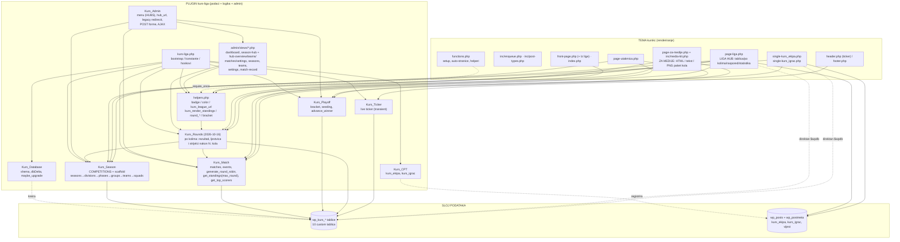
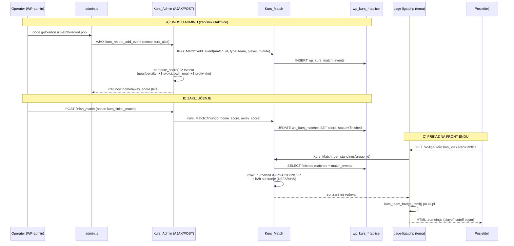

# ARHITEKTURA — kurskc.hr (KURS Liga)

> Pogled iz ptičje perspektive za AI sesije. Cilj: razumjeti kako se **plugin** (podaci + domenska logika + admin) i **tema** (renderiranje) povezuju, bez čitanja cijelog koda.
>
> **Napomena:** `CLAUDE.md` u korijenu repozitorija ranije je bio zastario (CPT-ovi `momcad`/`utakmica`, taksonomije `liga`/`sezona`, boje `--color-*`); ✅ ispravljen je 2026-06-22 i dopunjen 2026-10-16 (fiksna struktura, „Po kolima", „Za medije"). CLAUDE.md je sažetak — za detalje vjeruj ovom dokumentu i kodu.
>
> **2026-10-16 ukratko:** (1) struktura natjecanja je **hardkodirana** (`Kurs_Season::COMPETITIONS` — KC Liga = 2 lige bez playoffa, Pan = 1 liga s 2/4 skupine + playoff), nova sezona = natjecanje + godina; (2) round-robin je preseljen u domenu (`Kurs_Match::generate_round_robin()`); (3) nova read-only klasa **`Kurs_Rounds`** puni tab **„Po kolima"** u Liga hubu, sekciju „Iz lige" na naslovnici i novu javnu stranicu **„Za medije"** (`page-za-medije.php` + `inc/media-kit.php`); (4) **admin je preslagan po natjecanjima** (`KURS_VERSION` 1.16.0): svako natjecanje ima svoju stranicu (`kurs-kc` / `kurs-pan`, view `season-hub.php`) s karticama Pregled · Ekipe · Utakmice · Postavke, „Ekipe i igrači" je zajednički registar klubova, a stari slugovi (`kurs-season-setup`, `kurs-matches`, `kurs-roster`) samo preusmjeravaju — vidi §5.

---

## 1. Dvije komponente, jasna granica odgovornosti

Sustav su **dvije odvojene komponente** koje surađuju preko zajedničkog sloja podataka (WP postovi + custom DB tablice):

| Komponenta | Putanja | Odgovornost |
|---|---|---|
| **Plugin `kurs-liga`** | `app/public/wp-content/plugins/kurs-liga/` | **Podaci + logika + admin.** Custom DB tablice (`wp_kurs_*`), CPT-ovi `kurs_ekipa`/`kurs_igrac`, domenske klase (`Kurs_Season`, `Kurs_Match`, `Kurs_Playoff`, `Kurs_Rounds`, `Kurs_Ticker`), cijelo WP-admin sučelje za unos (klasa `Kurs_Admin` + viewovi), prezentacijski helperi i dijeljeni renderi (`includes/helpers.php`). |
| **Tema `kurskc`** | `app/public/wp-content/themes/kurskc/` | **Renderiranje (front-end).** Naslovnica, liga hub, centar utakmice, „Za medije", profili ekipe/igrača, vijesti. CPT `vijest` + taksonomija `vijest_kategorija`. Čita podatke kroz domenske metode plugina **i** direktnim `$wpdb` upitima na plugin tablice. |

**Granica:** plugin je **izvor istine** (write path = admin, read API = statičke metode). Tema je **isključivo prezentacija** i ne piše ligaške podatke; samo ih čita i prikazuje. Tema **funkcionalno ovisi o pluginu** — bez aktivnog plugina front-end lige ispisuje "plugin nije aktivan" (guard `class_exists('Kurs_Season')`).



---

## 2. Ključne ulazne točke

### `kurs-liga.php` (bootstrap plugina)
Definira konstante: `KURS_VERSION='1.33.2'` (header plugina i dalje `1.2.0`), `KURS_DIR`, `KURS_URL`, `KURS_PREFIX='kurs_'`, `KURS_CAP='manage_kurs_liga'`. Učitava (`require_once`) sve domenske klase (`class-database`, `helpers`, `class-playoff`, `class-cpt`, `class-season`, `class-match`, `class-ticker`, **`class-rounds`**, `class-roles`), te u adminu `admin/class-admin.php`. Instancira `new Kurs_CPT()` (registrira CPT-ove na `init`), `Kurs_Ticker::init()`, `Kurs_Roles::init()`. Veže:
- `add_action('plugins_loaded', ['Kurs_Database','maybe_upgrade'])` — migracija sheme na svakom učitavanju.
- `register_activation_hook` — `Kurs_Database::install()` (kreira tablice) + registracija CPT-ova + `flush_rewrite_rules()`.
- `init` 99 — jednokratni flush rewrite pravila (opcija `kurs_flush_needed`); `init` 100 — samoizlječenje: regenerira pravila ako u `rewrite_rules` nema `ekipe/…`.
- U adminu: `new Kurs_Admin()` (veže `admin_menu`, `admin_enqueue_scripts`, `admin_init` — uključujući `redirect_legacy_pages` na prioritetu 5 — filtere `parent_file`/`submenu_file` i `wp_ajax_*`).

### `functions.php` (bootstrap teme)
Konstante `KURSKC_VERSION='1.0.63'`, `KURSKC_DIR`, `KURSKC_URI`. Učitava `inc/post-types.php`, `inc/enqueue.php`, `inc/nav-menus.php`, `inc/news.php`, `inc/sponsors.php` i **`inc/media-kit.php`** (2026-10-16). **Ključno za spregu:** uvjetno `require_once WP_PLUGIN_DIR.'/kurs-liga/includes/helpers.php'` (ako funkcija `kurs_team_badge_html` ne postoji) — tema posuđuje prezentacijske helpere i renderere iz plugina. Automatski kreira WP stranice i dodjeljuje im Page Template metu (`_wp_page_template`): `kc-liga` + `pan-ljetna` → `page-liga.php`, `utakmica` → `page-utakmica.php`, **`za-medije` → `page-za-medije.php`**, `o-kurs-u` → `page-o-nama.php`. Skriva native "Objave"/"Komentari" iz admina; redirecta `edit.php` na `post_type=vijest`.

### `page-liga.php` (Liga Hub — glavni front-end ekran)
Template Name **"Liga Hub"**, dijeli se između stranica `/kc-liga/` i `/pan-ljetna/` (razlika po slugu: `$is_pan = (get_post_field('post_name') === 'pan-ljetna')`). Guard `class_exists('Kurs_Season')`. Kontekst se bira **isključivo GET parametrima** (nema ACF/meta): `?season_id` (mora pripadati natjecanju stranice), `?division_id` (mora pripadati sezoni — validira se od 2026-10-16), `?tab=tablica|kola|raspored|statistika` i, za tab „Po kolima", `?kolo=N|playoff`. Svi tabovi/filteri rade **server-side reloadom** (`<a href>` linkovi, sezona kroz `.hub-dd` dropdown linkova). URL huba iz bilo koje divizije gradi `kurs_league_url($division_id, $args)` (plugin helper).

### `page-za-medije.php` (Za medije — NOVO 2026-10-16)
Template Name **"Za medije"** (`/za-medije/?liga=kc|pan&season_id=&kolo=N|playoff`). Za odabrano kolo složi paket svih liga sezone preko `Kurskc_Media_Kit` (`inc/media-kit.php`, podaci iz `Kurs_Rounds`) u tri oblika: **HTML** (inline stilovi/tablice, preživljava `wp_kses_post`), **običan tekst** i **PNG** (html-to-image u pregledniku). Detalji u `TEMA-KURSKC.md` §16a.

---

## 3. Domenski model (sažeto)

Hijerarhija natjecanja živi u **custom tablicama** (`$wpdb->prefix . KURS_PREFIX . '<ime>'` = `wp_kurs_*`); ekipe i igrači su **WP postovi** referencirani preko ID-a.

```
season (sezona: league = 'kc_liga'|'pan_ljetna', name, year, status, locked)
 └─ division (liga: "KC Liga", "Liga bez briga" | "Pan Ljetna liga"; has_playoff, advance_per_group)
     └─ phase (uvijek jedna: "Grupna faza", type = 'group')
         └─ group (KC: jedna skupina = liga | Pan: Grupa A–B ili A–D; playoff_spots = koliko prolazi dalje)
             ├─ group_teams ──► kurs_ekipa  (WP post)
             └─ matches (utakmice grupne faze)
                 └─ match_events (goal | own_goal | yellow_card | red_card)
                                  └─ player_id ──► kurs_igrac (WP post)

squads        ──► visi o division_id (roster: igrač × ekipa × divizija, jersey_no) — trenutni
match_players ──► visi o match_id (postava utakmice spremljena pri završetku; od DB 1.12)
playoff_matches ──► visi o division_id (round qf|sf|final|3rd, slot, labeli A1/QF1-W, match_id→matches)
```

**10 custom tablica:** `seasons, divisions, phases, groups, group_teams, squads, matches, match_events, playoff_matches`. Strukturni `id` su `INT UNSIGNED`; stupci koji drže WP post ID (`team_id, player_id, home_team_id, away_team_id, scored_for`) su `BIGINT UNSIGNED` = `wp_posts.ID`.

**Veza s WP-om:** `team_id → kurs_ekipa` post, `player_id → kurs_igrac` post. WP post nosi **naziv** (`post_title`), **logo** (featured image) i **boju** (postmeta `_kurs_team_color`); custom tablice nose natjecateljske podatke. Relacije **nisu** DB FOREIGN KEY — integritet se održava u aplikacijskom kodu.

**Verzioniranje:** `Kurs_Database::DB_VERSION='1.16'` (opcija `kurs_db_version`); migracije u `maybe_upgrade()` na `plugins_loaded`. Napomena: plugin header Version je `1.2.0`, a `KURS_VERSION` `1.23.0` (različite sheme verzija koda i baze).

### Fiksna struktura natjecanja (`Kurs_Season::COMPETITIONS`, od 2026-10-16)
Sustav služi samo KURS-u, pa je format **u kodu**: `kc_liga` → lige *KC Liga* i *Liga bez briga*, svaka jedna skupina, jednokružno, bez playoffa; `pan_ljetna` → jedna liga *Pan Ljetna liga* s **2 ili 4** skupine (`PAN_GROUP_OPTIONS`), po 2 najbolje u playoff (4 skupine → četvrtfinale, 2 → polufinale). Admin kreira sezonu odabirom natjecanja + godine; `Kurs_Season::scaffold()` (idempotentno) kreira divizije, fazu „Grupna faza" i skupine; naziv daje `default_name()` („KC Liga 2026/2027", „Pan Ljetna liga 2026"). Pan broj skupina mijenja se samo kroz `set_group_count()` (2↔4; odbija kad postoji bracket ili kad uklonjene skupine imaju ekipe/utakmice; forma je na stranici natjecanja → kartica Ekipe). Ručno dodavanje divizija/faza/grupa i uređivanje `playoff_spots` je **uklonjeno**; skupine nasljeđuju `playoff_spots` iz divizije (0 bez playoffa).

### Tablica poretka (`Kurs_Match::get_standings($group_id, ?$max_round)`)
Računa se **dinamički** iz `finished` utakmica (nije perzistirana). Bodovanje: pobjeda 3 / remi 1 / poraz 0. Sortiranje **UEFA/HNS model**: 1. ukupni Pts → 2–4. **head-to-head mini-tablica** izjednačenih ekipa (h2h Pts→GD→GF) → 5. ukupni GD → 6. ukupni GF → 7. fair-play (FP = žuti×3 + crveni×10, niži = bolji). Opcionalni `$max_round` (2026-10-16) = ljestvica „nakon N. kola" (samo utakmice i kartoni iz kola ≤ N). Strijelci: `Kurs_Match::get_top_scorers($division_id, $limit)` (goal + penalty, vraća i `team_id`).

### Raspored (`Kurs_Match::generate_round_robin($group_id)`, od 2026-10-16)
Circle-method, jednokružno; neparan broj ekipa → „bye" (jedna ekipa slobodna po kolu); postojeći parovi se preskaču pa je sigurno pokrenuti ponovno („Dopuni raspored"). Ranije je živio u `Kurs_Admin::ajax_generate_fixtures()`.

### Pregled po kolima (`Kurs_Rounds`, NOVO 2026-10-16)
Read-only klasa nad grupnom fazom: kola i njihovo stanje (`round_status`), zadnje odigrano kolo (`default_round`), utakmice kola, strijelci po utakmici s kratkim imenima kao u medijima (`goals_by_match`, `short_names`), slobodna ekipa (`byes`), ljestvica nakon kola s pomakom (`standings`), strijelci nakon kola grupirani po broju golova (`scorers`), datum kola (`date_label`). Jedan izvor podataka za Liga hub (tab „Po kolima"), naslovnicu („Iz lige") i „Za medije".

### Playoff (`Kurs_Playoff`)
`generate($division_id)` uzima top `playoff_spots` ekipa iz svake grupe (preko `get_standings`), gradi seeding parove (`build_seeding_pairs`, predefinirane matrice 4×2, 2×2, 4×1 + generic), kreira bracket runde (qf→sf→final). `advance_winner` automatski gura pobjednika u sljedeći slot (neriješeno NE napreduje). Playoff meč se može lazy povezati sa zapisnikom (`ensure_match_record()` kreira red u `matches` s `group_id=0` kao playoff marker). `reset()` od 2026-10-16 briše i te zapisnike s eventima (ranije siročad); zove ga i `Kurs_Season::delete_division()`.

---

## 4. Tok podataka: od unosa rezultata u adminu do prikaza tablice poretka

Ovo je centralni tok koji povezuje obje komponente. Izvor istine za rezultat su **eventi** (golovi), a `home_score`/`away_score` su denormalizirani snapshot.



**Sažeto, korak po korak:**
1. **Unos** — `admin/views/match-record.php` → JS `admin.js` → AJAX `kurs_record_add_event` → `Kurs_Admin::ajax_record_add_event` → `Kurs_Match::add_event()` → INSERT u `wp_kurs_match_events`. Live rezultat računa `Kurs_Admin::compute_score()` (goal/penalty=+1 svojoj ekipi, own_goal=+1 protivniku, kartoni/prekršaji ne utječu).
2. **Zaključenje** — POST forma `finish_match` → `Kurs_Admin::do_finish_match` → `Kurs_Match::finish(id, home, away)` → UPDATE `wp_kurs_matches` (`status='finished'`, score snapshot) + `do_action('kurs_data_changed')` (ruši cache tickera i „aktivne lige"). Ako je meč povezan s playoffom, sinkronizira se i playoff zapis.
3. **Prikaz** — posjetitelj otvori `page-liga.php?tab=tablica` → tema zove `kurs_render_standings($group_id, …)` → `Kurs_Match::get_standings($group_id)` koji čita `finished` utakmice + kartone iz `match_events`, izračuna i sortira tablicu, vrati niz. Render ispisuje `.standings`, badge ekipe preko `kurs_team_badge_html()` (iz plugin `helpers.php`), boja označava playoff cutoff (`$i < playoff_spots`; 0 za lige bez playoffa).
4. **Po kolima / Za medije (2026-10-16)** — `?tab=kola&kolo=N` i `/za-medije/?kolo=N` čitaju iste podatke kroz `Kurs_Rounds` (rezultati kola + strijelci iz `match_events`, `get_standings($gid, N)` za ljestvicu nakon kola i pomak u odnosu na prethodno kolo).

> **Write path** je uvijek admin (`Kurs_Admin` → domenske klase). **Read path** je tema (domenske metode + direktni `$wpdb`). Tema nikad ne piše.

---

## 5. Workflow operatera (end-to-end, admin)

**Izbornik „KURS Liga" (od 1.16.0):**

| Slug | Stranica | Uloga |
|---|---|---|
| `kurs-dashboard` | **Pregled** (`dashboard.php`) | Kartice oba natjecanja (aktualna sezona, „N ekipa · X. kolo od Y · vodi …") + „Čeka rezultat" / „Ovaj tjedan" / „Zadnji rezultati" preko svih aktivnih nezaključanih sezona |
| `kurs-kc`, `kurs-pan` | **Stranica natjecanja** (`season-hub.php`) | Aktualna sezona natjecanja (+ odabir starijih); kartice `?tab=` **pregled** (koraci, lige, utakmice koje traže pažnju) · **ekipe** (ekipe u ligama/skupinama, broj skupina, generiranje rasporeda) · **utakmice** (ljestvica, raspored po kolima, playoff) · **postavke** (sezona, suci sezone, zaključavanje, brisanje) |
| `kurs-teams` | **Ekipe** (`teams.php`) | Zajednički registar klubova; podaci ekipe + popis liga s linkom na roster |
| `kurs-players` | **Igrači** (`players.php`, 1.19.0) | Registar igrača: tražilica, podaci (pozicija, godina rođenja, fotografija), karijera, spajanje dvostrukih upisa, brisanje bez utakmica (`Kurs_Players`) |
| `kurs-seasons` | **Sve sezone** (`seasons.php`) | Arhiva sezona po natjecanju + „Nova sezona" |
| `kurs-settings` | **Postavke** (`settings.php`) | Ticker izvan sezone; uputa da su suci na stranici natjecanja → Postavke |
| `kurs-match-record` | Zapisnik (skriven) | Otvara se iz utakmice; izbornik pritom označi natjecanje |

Linkovi i redirecti na stranicu natjecanja grade se **isključivo** preko `Kurs_Admin::hub_url($season_id, $tab, $args)` (bira `kurs-kc`/`kurs-pan` po ligi sezone). Stari slugovi `kurs-season-setup` / `kurs-matches` / `kurs-roster` (i `kurs-seasons&action=edit`) ostaju registrirani samo da ih `redirect_legacy_pages()` preusmjeri na odgovarajuću karticu.

**Tok rada:**
1. **Sezona** — „+ Nova sezona" na stranici natjecanja ili „Sve sezone" (`create_season`; za natjecanje bez sezone i inline „Kreiraj prvu sezonu"): samo **natjecanje + godina** (za Pan i broj skupina 2/4, uz live pregled). Validacija natjecanja/godine, odbijanje duplikata (`find_for` → `&exists=`), `default_name()` + `scaffold()` → redirect na karticu **Ekipe** (`hub_url($id, 'ekipe', ['created'=>1])`).
2. **Ekipe u ligama** — kartica Ekipe: za Pan forma broja skupina (`set_group_count`); stupci liga/skupina jedan do drugog + popis „Ekipe koje nisu u ligi" s gumbima „+ liga/skupina" (`kurs_assign_team`); uvrštavanje i micanje uvijek preko dijaloga potvrde, s „Poništi" (1.23.0); nova ekipa AJAX-om (`kurs_create_team` = `wp_insert_post(kurs_ekipa)`). Guardovi: ekipa u najviše jednoj skupini po ligi, ne miče se dok ima utakmica, ništa u zaključanoj sezoni.
3. **Raspored** — dno kartice Ekipe „Generiraj raspored →" / „↻ Dopuni raspored" (POST `generate_season_fixtures` → `Kurs_Match::generate_round_robin()` za sve skupine sezone), ili po skupini u kartici Utakmice (AJAX `kurs_generate_fixtures`) / ručno (`add_match`). Datum/kolo preko ✎ (`kurs_update_match`).
4. **Roster** — „N igr." uz ekipu (kartica Ekipe) → `kurs-teams&action=edit&id=&division_id=`: igrači (`kurs_igrac` postovi) u squad te lige; „← Natrag na ligu".
5. **Zapisnik** — iz „Čeka rezultat" (Pregled) ili rasporeda → `kurs-match-record`: eventi + `finish_match` (vidi tok gore). PDF preko `?format=pdf` (browser print-to-PDF). Povratak na karticu Utakmice.
6. **Za medije** — „Za medije ↗" u zaglavlju stranice natjecanja otvara javnu `/za-medije/?liga=&season_id=` s paketom rezultata kola.
7. **Playoff (Pan)** — kartica Utakmice → „🏆 Playoff" (`playoff_div=`): `generate_playoff` iz ljestvica, unos rezultata, `advance_winner`.
8. **Kraj sezone** — kartica Postavke → `toggle_season_lock` (zaključana sezona = konačni podaci; kartica Ekipe postaje samo za čitanje).

Sigurnost admina: capability **`KURS_CAP`** (`manage_kurs_liga` — administrator + uloga Author preko `Kurs_Roles`; ranije `manage_options`) svuda, osim zapisnika: AJAX `kurs_record_*` i forme završi/otvori za ispravak traže **`KURS_RECORD_CAP`** (`kurs_zapisnik` — i uloga **Zapisničar**, koja zapisnik vodi na **`/zapisnik/`**, `Kurs_Zapisnik`, bez wp-admina; 1.24.0); POST forme imaju vlastiti `check_admin_referer` + PRG (`wp_safe_redirect`+`exit`); svi AJAX dijele jedan nonce `kurs_ajax` (`check_ajax_referer('kurs_ajax','nonce')`).

---

## 6. Front-end točke prikaza (tema)

| Datoteka | Ekran | Glavni izvori podataka |
|---|---|---|
| `front-page.php` | Naslovnica | vijesti (`get_posts`), statične liga kartice; **„Iz lige"** (2026-10-16): `kurskc_active_league()` → za svaku ligu sezone `Kurs_Rounds::default_round/matches/round_status/date_label` + vodeći iz `get_standings` |
| `page-liga.php` | **Liga Hub** | tablica: `kurs_render_standings()` + `kurs_render_playoff_bracket()`; **po kolima**: `Kurs_Rounds` + `kurs_render_round_results/round_scorers`; statistika: `Kurs_Match::get_top_scorers`; direktni `$wpdb` (raspored, disciplina) |
| `page-za-medije.php` | **Za medije** (2026-10-16) | `Kurskc_Media_Kit` (tema) nad `Kurs_Rounds` + `Kurs_Playoff::get_bracket` |
| `page-utakmica.php` | Centar utakmice (`?match_id=`) | `Kurs_Match::get/get_events`, `Kurs_Match::lineup` (spremljena postava) + `$wpdb` kontekst; playoff meč → `Kurs_Playoff::find_by_match_id()`; linkovi `kurs_league_url()` |
| `single-kurs_ekipa.php` | Profil ekipe | `Kurs_Season::get_team_contexts/get_squad`, `Kurs_Match::get_standings` + `$wpdb` (forma, sve utakmice) |
| `single-kurs_igrac.php` | Profil igrača | isključivo direktni `$wpdb` (karijera) |
| `header.php` | Live ticker | `Kurs_Ticker::get_state()` (plugin, transient cache; samo ako `class_exists('Kurs_Ticker')`) |

**Helperi za prikaz** (plugin `includes/helpers.php`, dijele plugin i tema): `kurs_team_badge_html()` (avatar/inicijali), `kurs_team_color()` (meta `_kurs_team_color`, default `#1a3a6b`), `kurs_team_text_color()` (WCAG luminancija), `kurs_league_icon()`, **`kurs_league_url()`** (URL huba prave lige iz `division_id`), `kurs_render_standings()` (+ `max_round`/`rows`/`show_move`), `kurs_render_playoff_bracket()` + `kurs_playoff_label()`, **`kurs_render_round_results()`**, **`kurs_render_round_scorers()`**, `kurs_schedule_date_label()`. Relativno vrijeme `kurs_time_ago()` je u temi (`functions.php`).

**CSS varijable** (stvarne, u `assets/css/main.css`): brend `--c-kc #DA0F1E` (KC liga), `--c-pan #F47B16` (Pan ljetna), `--c-gold #FDE206`; `--c-win/--c-draw/--c-loss`. (Ne postoje `--color-primary`/`--color-accent` iz CLAUDE.md.)

> Front-end **miješa pristup**: dio podataka preko domenskih metoda plugina, dio preko ad-hoc `$wpdb` SQL-a u predlošcima (prefiks `$wpdb->prefix.'kurs_'`). Promjena sheme tablica zato zahtijeva izmjene i u pluginu i u više template datoteka.

---

## 7. Gotchas / mrtvi kod (za buduće sesije)

> ⚠️ Dio dolje navedenih grešaka **ISPRAVLJEN je 2026-06-22 i 2026-10-16** — vidi [`ISPRAVCI.md`](ISPRAVCI.md). Ispravljeno je označeno s ✅.

- ✅ **CLAUDE.md ažuriran** — ranije je bio zastario (spominjao CPT-ove `momcad`/`utakmica`, taksonomije `liga`/`sezona`, boje `--color-primary`/`--color-accent`); sada točno opisuje `kurs_ekipa`/`kurs_igrac` (plugin), `vijest` + `vijest_kategorija` (tema) i boje `--c-*`.
- ✅ **Round-robin je u domeni** od 2026-10-16 (`Kurs_Match::generate_round_robin()`). **`compute_score` je i dalje u admin sloju** (`Kurs_Admin`) — pravila golova (goal/penalty +1, own_goal +1 protivniku) ponavljaju se i u `Kurs_Rounds::goals_by_match()`.
- **Struktura natjecanja je u kodu** (`Kurs_Season::COMPETITIONS`), ne u bazi: nova liga/format = izmjena konstante (i seeding matrice u `Kurs_Playoff` za drugi broj skupina). `scaffold()` ne dira sezone koje već imaju divizije.
- **Hook `kurs_data_changed`** — svaka write operacija koja mijenja rezultat/raspored mora ga okinuti (ticker i `kurskc_active_league` imaju cache).
- ✅ **`maybe_upgrade()` više ne koristi `ADD COLUMN IF NOT EXISTS`** (ISPRAVCI #1) — nove stupce dodaje `dbDelta` preko `install()`; ostao samo valjani `MODIFY` za `seasons.league`.
- ✅ **Napuštena playoff stranica uklonjena (1.16.0):** `pg_playoff()` + `playoff.php` (stranica `kurs-playoff` nikad nije bila registrirana) obrisani su zajedno s `season-setup.php`, `roster.php` i `pg_setup/pg_matches/pg_roster`; `matches.php` je postao `hub-matches.php`. Playoff je u kartici Utakmice stranice natjecanja.
- **Admin linkovi:** uvijek `Kurs_Admin::hub_url()`; legacy slugovi moraju ostati registrirani (`__return_null`) jer WP provjerava pristup stranici prije `admin_init`, pa bi bez toga stari link pao prije preusmjeravanja.
- **Integritet ekipa je u admin handlerima, ne u domeni** (nema FK): `ajax_assign_team` (jedna skupina po ligi), `ajax_remove_team` (ne dok ima utakmica), `do_delete_team` (ne dok ima ijednu utakmicu; inače briše i `group_teams`/`squads`) — vidi ISPRAVCI #20–#22.
- **Mrtvi stupac** `match_events.scored_for` (nigdje se ne piše/čita). **Mrtva grana** round `3rd` (utakmica za 3. mjesto se nigdje ne generira). *(Namjerno ostavljeno — vidi ISPRAVCI.)*
- **Rute teme:** ✅ footer više ne linka na nepostojeći `/liga/` nego na `/kc-liga/` i `/pan-ljetna/` (ISPRAVCI #7), usklađeno s headerom. ✅ Breadcrumb u `page-utakmica.php` više ne vodi uvijek na `/kc-liga/` — koristi `kurs_league_url()` i radi i za playoff mečeve (ISPRAVCI #9). Stranice `kontakt` i pravne stranice (`kolacici`, `privatnost`, `uvjeti-koristenja`) `functions.php` u međuvremenu kreira automatski (ako ne postoje).
- **`reopen()` razlika je namjerna:** `Kurs_Match::reopen()` NE briše score (operater zadržava uneseni rezultat pri otključavanju; `get_standings()` ionako broji samo `status='finished'`), dok `Kurs_Playoff::reopen_match()` ga postavlja na NULL.
- **Registrirani nav izbornici** (`primary`/`footer`) i `the_custom_logo()` se ne koriste — navigacija i logo su hardkodirani.
- ✅ **`match-record-pdf.php` ispravljen** (ISPRAVCI #2–4): `$disp_home/$disp_away/$is_finished` računaju se prije PDF includea, PDF se renderira na `admin_init` (nema više "headers already sent"), a footer datum koristi `date_i18n('j.n.Y. \u H:i')`.
