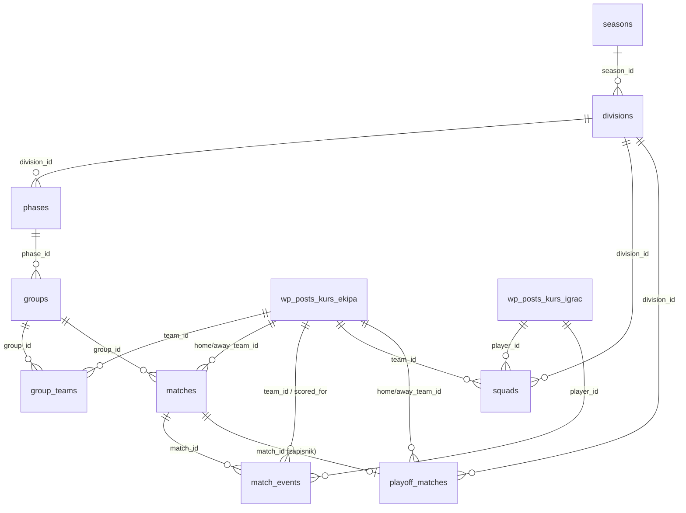

# BAZA PODATAKA — Plugin KURS Liga

> Baza znanja o sloju podataka plugina **KURS Liga** (`app/public/wp-content/plugins/kurs-liga/`).
> Cilj: omogućiti drugoj AI sesiji da razumije strukturu podataka bez čitanja cijelog koda.
> Sve činjenice su provjerene u stvarnom kodu (`includes/class-database.php`, `includes/class-cpt.php`, `includes/helpers.php`, `kurs-liga.php`, `app/public/kurs_seed.sql`).
>
> ⚠️ **Stanje sheme:** ovaj dokument detaljno opisuje shemu do `DB_VERSION` **1.5**. Kod je na **`DB_VERSION = '1.16'`** — dodani su stupci (1.12) nova tablica **`match_players`** — postava utakmice spremljena pri završetku (`match_id, team_id, player_id, jersey_no`, UNIQUE(match_id, player_id)); karijera i sastavi čitaju nju, a ne trenutni `squads`. Ranije su dodani stupci `seasons.locked`, `seasons.max_fouls_per_half`, `seasons.referees` (1.10, JSON `[{ime, prezime}]` — baza sudaca sezone), `playoff_matches.home_pen/away_pen` (1.11, penali kod neriješenog), `divisions.has_playoff`, `divisions.advance_per_group`, `divisions.base_round` (1.14 — kolo do kojeg su postignuti preneseni golovi igrača), preneseno stanje `group_teams.base_*`/`rank_hint` i `squads.base_goals/base_own_goals` (1.13), `matches.referee1/referee2`, `match_events.half`, a `event_type` danas obuhvaća `goal|penalty|own_goal|yellow_card|second_yellow|red_card|foul` (+ inertni `captain`/`absent`). Sažetak je u `PLUGIN-KURS-LIGA.md` §3.2; mjerodavan je `includes/class-database.php`.
>
> **2026-10-16 — kako nastaju redovi strukture:** shema se nije mijenjala, ali se redovi `divisions` / `phases` / `groups` više **ne unose ručno** — kreira ih `Kurs_Season::scaffold()` pri kreiranju sezone prema konstanti `Kurs_Season::COMPETITIONS`:
> - `seasons.league` = `kc_liga` → `divisions`: „KC Liga" (`sort_order` 0) + „Liga bez briga" (1), `has_playoff=0`, `advance_per_group=0`; po diviziji jedna faza „Grupna faza" (`type='group'`) i **jedna** grupa s imenom divizije, `playoff_spots=0`.
> - `seasons.league` = `pan_ljetna` → jedna divizija „Pan Ljetna liga", `has_playoff=1`, `advance_per_group=2`; faza „Grupna faza"; **2 ili 4** grupe „Grupa A"…„Grupa D", `playoff_spots=2`.
> - `seasons.name` = „KC Liga 2026/2027" / „Pan Ljetna liga 2026" (`default_name()`); duplikat (isto `league` + `year`) admin odbija.
> - `groups.playoff_spots` se upisuje iz divizije (`create_group()`), DB default 2 se u praksi ne koristi.
> - `Kurs_Playoff::reset()` (i `delete_division()`) briše i playoff zapisnike: redove `matches` s **`group_id = 0`** čiji je `id` u `playoff_matches.match_id`, plus njihove `match_events`.

---

## 1. Uvod

Plugin **KURS Liga** implementira sustav za vođenje malonogometnih liga (KC liga, Pan ljetna liga). Sloj podataka je podijeljen na **dva mjesta**:

1. **Custom DB tablice** s prefiksom `wp_kurs_` — drže cijelu natjecateljsku strukturu (sezone, divizije, faze, grupe, utakmice, događaji, playoff). Definirane su u `includes/class-database.php` i kreiraju se preko WordPress funkcije `dbDelta`.
2. **WordPress postovi (CPT)** — `kurs_ekipa` (ekipe) i `kurs_igrac` (igrači), definirani u `includes/class-cpt.php`. Custom tablice referenciraju te postove preko stupaca `team_id` / `player_id` koji su jednaki `wp_posts.ID`.

Bootstrap, konstante i hookovi nalaze se u glavnoj datoteci `kurs-liga.php`.

### 1.1 Bootstrap i konstante (`kurs-liga.php`)

| Konstanta | Vrijednost | Značenje |
|-----------|-----------|----------|
| `KURS_VERSION` | `'1.36.0'` | Verzija koda plugina (header plugina je `1.2.0` — ne podiže se) |
| `KURS_DIR` | `plugin_dir_path(__FILE__)` | Apsolutna putanja do plugina |
| `KURS_URL` | `plugin_dir_url(__FILE__)` | URL do plugina |
| `KURS_PREFIX` | `'kurs_'` | Prefiks za DB tablice; sklapa se kao `$wpdb->prefix . KURS_PREFIX` → npr. `wp_kurs_` |

**Uključene datoteke (`require_once`):** `class-database.php`, `helpers.php`, `class-playoff.php`, `class-cpt.php`, `class-season.php`, `class-match.php`, `class-ticker.php`, `class-rounds.php` (2026-10-16, samo čitanje), `class-roles.php`. U adminu dodatno `admin/class-admin.php`.

**Instanciranje i hookovi:**
- `new Kurs_CPT();` — instancira se odmah (konstruktor veže `register()` na `init`).
- `add_action( 'plugins_loaded', [ 'Kurs_Database', 'maybe_upgrade' ] )` — provjera/migracija sheme pri svakom učitavanju.
- `register_activation_hook( __FILE__, [ 'Kurs_Database', 'install' ] )` — kreiranje tablica pri aktivaciji.
- Drugi `register_activation_hook` — poziva `(new Kurs_CPT())->register()` + `flush_rewrite_rules()`.
- `init` 99 — jednokratni `flush_rewrite_rules()` ako je postavljena opcija `kurs_flush_needed`; `init` 100 — samoizlječenje: ako u spremljenim `rewrite_rules` nema pravila `ekipe/…`, pravila se regeneriraju.

---

## 2. Pregled hijerarhije

Natjecateljska struktura je strogo hijerarhijska, od sezone prema dolje:

```
SEZONA (seasons)
  └─ DIVIZIJA (divisions)              "KC Liga", "Liga bez briga" | "Pan Ljetna liga"
       ├─ FAZA (phases)               uvijek jedna: "Grupna faza" (type 'group')
       │    └─ GRUPA (groups)         KC: jedna, ime lige | Pan: "Grupa A".."Grupa D"
       │         ├─ EKIPE U GRUPI (group_teams)
       │         └─ UTAKMICE (matches)
       │              └─ DOGAĐAJI (match_events)   golovi / kartoni
       ├─ ROSTER (squads)             igrači po ekipi unutar divizije
       └─ PLAYOFF (playoff_matches)   bracket: qf / sf / final / 3rd
```

Ključno razgraničenje odgovornosti:
- **WP postovi** (`kurs_ekipa`, `kurs_igrac`) nose **identitet** entiteta: naziv (`post_title`), logo (featured image), boju ekipe (postmeta `_kurs_team_color`).
- **Custom tablice** nose **natjecateljske podatke**: tko igra gdje, rezultate, raspored, događaje, playoff.

---

## 3. ER dijagram

Relacije nisu deklarirane kao prave baze (`FOREIGN KEY`) — održavaju se u aplikacijskom kodu. Indeksi `idx_*` postoje za performanse.



Tekstualni prikaz hijerarhije s tipovima veza:

```
seasons (1) ──< (N) divisions ──< (N) phases ──< (N) groups ──< (N) group_teams >── (1) kurs_ekipa [WP post]
                     │                                  │
                     │                                  └──< (N) matches ──< (N) match_events
                     │                                                              │
                     │                                                  player_id ──┘ → kurs_igrac [WP post]
                     │                                                  team_id / scored_for → kurs_ekipa [WP post]
                     │
                     ├──< (N) squads >── player_id → kurs_igrac [WP post]
                     │                   team_id   → kurs_ekipa [WP post]
                     │
                     └──< (N) playoff_matches (home/away_team_id → kurs_ekipa; match_id → matches)
```

### 3.1 Sažetak relacija

- **seasons 1—N divisions** (`divisions.season_id`)
- **divisions 1—N phases** (`phases.division_id`)
- **phases 1—N groups** (`groups.phase_id`)
- **groups 1—N group_teams** (`group_teams.group_id`); `group_teams.team_id` → `kurs_ekipa` post
- **groups 1—N matches** (`matches.group_id`); domaća/gostujuća ekipa → `kurs_ekipa` postovi
- **matches 1—N match_events** (`match_events.match_id`)
- **divisions 1—N squads** (`squads.division_id`); roster veže igrača (`kurs_igrac`) i ekipu (`kurs_ekipa`)
- **divisions 1—N playoff_matches** (`playoff_matches.division_id`); opcionalno povezan s `matches` preko `match_id`

---

## 4. Referenca tablica

Sve tablice kreira `Kurs_Database::install()` u `includes/class-database.php`. Prefiks: `$p = $wpdb->prefix . KURS_PREFIX` (npr. `wp_kurs_`). Koristi se `$wpdb->get_charset_collate()`. Nakon kreiranja izvršava se `update_option('kurs_db_version', DB_VERSION)` i `flush_rewrite_rules()`.

> **Konvencija tipova:** strukturni entiteti (`seasons`, `divisions`, `phases`, `groups`, `matches`, ...) imaju `id INT UNSIGNED`. Stupci koji drže **WP post ID-eve** (`team_id`, `player_id`, `home_team_id`, `away_team_id`, `scored_for`) su `BIGINT UNSIGNED` jer odgovaraju `wp_posts.ID`.

### 4.1 `wp_kurs_seasons` — Sezone natjecanja

| Stupac | Tip | Default | Značenje |
|--------|-----|---------|----------|
| `id` | INT UNSIGNED, AUTO_INCREMENT, PK | — | Primarni ključ |
| `league` | VARCHAR(100) NOT NULL | — | Natjecanje. Tip je i dalje VARCHAR (komentar „slobodan unos"), ali nove sezone (od 2026-10-16) uvijek dobivaju ključ iz `Kurs_Season::COMPETITIONS`: `kc_liga` ili `pan_ljetna`. Kod razlikuje Pan po podnizu „pan" (`is_pan_league()`). |
| `name` | VARCHAR(150) NOT NULL | — | Naziv sezone |
| `year` | SMALLINT UNSIGNED NOT NULL | — | Godina |
| `status` | VARCHAR(20) NOT NULL | `'active'` | Status sezone |
| `created_at` | DATETIME NOT NULL | `CURRENT_TIMESTAMP` | Vrijeme kreiranja |

**Ključevi:** `PRIMARY KEY (id)`, `KEY idx_status (status)`.

### 4.2 `wp_kurs_divisions` — Divizije unutar sezone

KC liga ima dvije divizije („KC Liga", „Liga bez briga"), Pan jednu („Pan Ljetna liga") — od 2026-10-16 ih kreira `Kurs_Season::scaffold()`. (Stupci `has_playoff` / `advance_per_group` iz kasnijih verzija sheme nisu u tablici niže.)

| Stupac | Tip | Default | Značenje |
|--------|-----|---------|----------|
| `id` | INT UNSIGNED, AUTO_INCREMENT, PK | — | PK |
| `season_id` | INT UNSIGNED NOT NULL | — | FK → `seasons.id` |
| `name` | VARCHAR(100) NOT NULL | — | Naziv divizije |
| `sort_order` | TINYINT UNSIGNED NOT NULL | `0` | Redoslijed prikaza |

**Ključevi:** `PRIMARY KEY (id)`, `KEY idx_season (season_id)`.

### 4.3 `wp_kurs_phases` — Faze unutar divizije

Od 2026-10-16 svaka divizija ima točno jednu fazu „Grupna faza" (`type='group'`, kreira je `scaffold()`); faze tipa `'playoff'` se više ne kreiraju — playoff živi u `playoff_matches`.

| Stupac | Tip | Default | Značenje |
|--------|-----|---------|----------|
| `id` | INT UNSIGNED, AUTO_INCREMENT, PK | — | PK |
| `division_id` | INT UNSIGNED NOT NULL | — | FK → `divisions.id` |
| `name` | VARCHAR(100) NOT NULL | — | Naziv faze |
| `type` | VARCHAR(20) NOT NULL | `'group'` | Tip faze (`group` i sl.) |
| `sort_order` | TINYINT UNSIGNED NOT NULL | `0` | Redoslijed |

**Ključevi:** `PRIMARY KEY (id)`, `KEY idx_division (division_id)`.

### 4.4 `wp_kurs_groups` — Grupe unutar grupne faze

KC: jedna grupa s imenom lige („KC Liga", „Liga bez briga"); Pan: „Grupa A"…„Grupa D" (2 ili 4, `Kurs_Season::set_group_count()`).

| Stupac | Tip | Default | Značenje |
|--------|-----|---------|----------|
| `id` | INT UNSIGNED, AUTO_INCREMENT, PK | — | PK |
| `phase_id` | INT UNSIGNED NOT NULL | — | FK → `phases.id` |
| `name` | VARCHAR(50) NOT NULL | — | Naziv grupe |
| `playoff_spots` | TINYINT UNSIGNED NOT NULL | `2` | Broj ekipa iz grupe koje prolaze u playoff (dodano u v1.2). `Kurs_Season::create_group()` uvijek upisuje vrijednost iz divizije (`advance_per_group`, ili **0** kad divizija nema playoff — KC lige). Od 2026-10-16 se više ne uređuje iz admina. |

**Ključevi:** `PRIMARY KEY (id)`, `KEY idx_phase (phase_id)`.

### 4.5 `wp_kurs_group_teams` — Ekipe dodijeljene grupama

| Stupac | Tip | Default | Značenje |
|--------|-----|---------|----------|
| `id` | INT UNSIGNED, AUTO_INCREMENT, PK | — | PK |
| `group_id` | INT UNSIGNED NOT NULL | — | FK → `groups.id` |
| `team_id` | **BIGINT UNSIGNED** NOT NULL | — | **WP post ID ekipe** (`kurs_ekipa` post) |

**Ključevi:** `PRIMARY KEY (id)`, `UNIQUE KEY uq_team_group (group_id, team_id)` — ista ekipa ne može dvaput u istu grupu.

### 4.6 `wp_kurs_squads` — Roster (igrači po ekipi i diviziji)

Igrač može igrati u više divizija iste sezone, zato je `division_id` dio jedinstvenog ključa.

| Stupac | Tip | Default | Značenje |
|--------|-----|---------|----------|
| `id` | INT UNSIGNED, AUTO_INCREMENT, PK | — | PK |
| `player_id` | **BIGINT UNSIGNED** NOT NULL | — | **WP post ID igrača** (`kurs_igrac` post) |
| `team_id` | **BIGINT UNSIGNED** NOT NULL | — | **WP post ID ekipe** (`kurs_ekipa` post) |
| `division_id` | INT UNSIGNED NOT NULL | — | FK → `divisions.id` |
| `jersey_no` | TINYINT UNSIGNED (nullable) | — | Broj dresa |

**Ključevi:** `PRIMARY KEY (id)`, `UNIQUE KEY uq_squad (player_id, team_id, division_id)`.

### 4.7 `wp_kurs_matches` — Utakmice (grupna faza)

| Stupac | Tip | Default | Značenje |
|--------|-----|---------|----------|
| `id` | INT UNSIGNED, AUTO_INCREMENT, PK | — | PK |
| `group_id` | INT UNSIGNED NOT NULL | — | FK → `groups.id` |
| `home_team_id` | **BIGINT UNSIGNED** NOT NULL | — | WP post ID domaće ekipe |
| `away_team_id` | **BIGINT UNSIGNED** NOT NULL | — | WP post ID gostujuće ekipe |
| `home_score` | TINYINT UNSIGNED (nullable) | — | Golovi domaćih |
| `away_score` | TINYINT UNSIGNED (nullable) | — | Golovi gostiju |
| `match_date` | DATETIME (nullable) | — | Termin utakmice |
| `round` | TINYINT UNSIGNED (nullable) | — | Kolo |
| `status` | VARCHAR(20) NOT NULL | `'scheduled'` | Status (`scheduled`, `finished`, ...) |
| `created_at` | DATETIME NOT NULL | `CURRENT_TIMESTAMP` | Vrijeme kreiranja |

**Ključevi:** `PRIMARY KEY (id)`, `KEY idx_group (group_id)`, `KEY idx_status (status)`.

### 4.8 `wp_kurs_match_events` — Događaji na utakmici

Golovi, autogolovi, kartoni s minutama i igračima.

| Stupac | Tip | Default | Značenje |
|--------|-----|---------|----------|
| `id` | INT UNSIGNED, AUTO_INCREMENT, PK | — | PK |
| `match_id` | INT UNSIGNED NOT NULL | — | FK → `matches.id` |
| `team_id` | **BIGINT UNSIGNED** NOT NULL | — | WP post ID ekipe kojoj se događaj pripisuje |
| `player_id` | **BIGINT UNSIGNED** (nullable) | — | WP post ID igrača |
| `event_type` | VARCHAR(20) NOT NULL | — | `goal` \| `own_goal` \| `yellow` \| `red` |
| `minute` | TINYINT UNSIGNED (nullable) | — | Minuta |
| `scored_for` | BIGINT UNSIGNED (nullable) | — | Za autogol: WP post ID tima koji prima gol |

**Ključevi:** `PRIMARY KEY (id)`, `KEY idx_match (match_id)`, `KEY idx_player (player_id)`.

### 4.9 `wp_kurs_playoff_matches` — Playoff bracket

| Stupac | Tip | Default | Značenje |
|--------|-----|---------|----------|
| `id` | INT UNSIGNED, AUTO_INCREMENT, PK | — | PK |
| `division_id` | INT UNSIGNED NOT NULL | — | FK → `divisions.id` |
| `round` | VARCHAR(20) NOT NULL | — | `qf` \| `sf` \| `final` \| `3rd` |
| `slot` | TINYINT UNSIGNED NOT NULL | — | Pozicija unutar runde (1, 2, 3, 4) |
| `home_team_id` | BIGINT UNSIGNED | `NULL` | WP post ID domaće ekipe (može biti NULL dok nije poznata) |
| `away_team_id` | BIGINT UNSIGNED | `NULL` | WP post ID gostujuće ekipe |
| `home_score` | TINYINT UNSIGNED | `NULL` | Golovi domaćih |
| `away_score` | TINYINT UNSIGNED | `NULL` | Golovi gostiju |
| `status` | VARCHAR(20) NOT NULL | `'scheduled'` | Status |
| `match_date` | DATETIME | `NULL` | Termin |
| `home_label` | VARCHAR(20) | `NULL` | Tekstualni placeholder, npr. "A1", "QF1-W" |
| `away_label` | VARCHAR(20) | `NULL` | Tekstualni placeholder |
| `match_id` | BIGINT UNSIGNED | `NULL` | FK → `kurs_matches.id` (zapisnik) — dodano u v1.5 |

**Ključevi:** `PRIMARY KEY (id)`, `KEY idx_division (division_id)`, `KEY idx_round (division_id, round)`.

> **Gotcha tipova:** `playoff_matches.match_id` je `BIGINT UNSIGNED` iako pokazuje na `matches.id` koji je `INT UNSIGNED`. Neusklađenost tipova FK-a, ali funkcionalno radi.

---

### 4.10 `wp_kurs_stats` — Statistika posjeta (1.15)

Jedan redak po pregledu javne stranice (`Kurs_Stats`). Bez IP adrese i kolačića.

| Stupac | Tip | Značenje |
|---|---|---|
| `id` | BIGINT UNSIGNED AI | PK |
| `ts`, `day` | DATETIME, DATE | vrijeme pregleda (lokalno, Europe/Zagreb) |
| `visitor` | CHAR(16) | dnevni anonimni hash (sol se mijenja svaki dan) |
| `entry` | TINYINT(1) | 1 = prvi pregled posjetitelja u danu (= jedan posjet) |
| `ptype`, `obj`, `league` | VARCHAR(16), BIGINT, VARCHAR(4) | vrsta stranice, ID (post / match_id / season_id), `kc`/`pan` |
| `path` | VARCHAR(191) | put s dopuštenim parametrima |
| `src`, `ref` | VARCHAR(16), VARCHAR(100) | izvor (`izravno/facebook/instagram/trazilice/interno/ostalo`) + domena |
| `device` | VARCHAR(8) | `mobitel` / `tablet` / `racunalo` |

Indeksi: `idx_day (day, visitor)`, `idx_obj (ptype, obj)`. Brisanje starijih od 760 dana: cron `kurs_stats_cleanup`.

### 4.11 `wp_kurs_requests` — Zahtjevi ekipa s portala (1.16)

| Stupac | Tip | Značenje |
|---|---|---|
| `id` | BIGINT UNSIGNED AI | PK |
| `team_id`, `division_id` | BIGINT, INT | ekipa (`kurs_ekipa`) i liga čiji se roster mijenja |
| `type` | VARCHAR(20) | `player_add/player_edit/player_remove/logo/sponsor_add/sponsor_remove/info/note` |
| `data` | LONGTEXT (JSON) | sadržaj zahtjeva (npr. `{player_id, old_name, name, old_number, number}`) |
| `status` | VARCHAR(10) | `pending` / `approved` / `rejected` / `cancelled` |
| `who`, `created` | VARCHAR(80), DATETIME | tko je poslao (upisano na portalu) i kada |
| `decided`, `decided_by`, `admin_note` | DATETIME, BIGINT, VARCHAR(255) | odluka KURS-a i napomena ekipi |

Indeksi `idx_team (team_id, status)`, `idx_status (status)`. Primjena tek odobrenjem (`Kurs_Portal::apply()`).

## 5. Veze prema WordPress postovima (CPT)

### 5.1 Mapiranje stupaca na postove

| Tablica.stupac | Pokazuje na | CPT |
|----------------|-------------|-----|
| `group_teams.team_id` | `wp_posts.ID` | `kurs_ekipa` |
| `squads.team_id` | `wp_posts.ID` | `kurs_ekipa` |
| `squads.player_id` | `wp_posts.ID` | `kurs_igrac` |
| `matches.home_team_id` / `matches.away_team_id` | `wp_posts.ID` | `kurs_ekipa` |
| `match_events.team_id` | `wp_posts.ID` | `kurs_ekipa` |
| `match_events.player_id` | `wp_posts.ID` | `kurs_igrac` |
| `match_events.scored_for` | `wp_posts.ID` | `kurs_ekipa` |
| `playoff_matches.home_team_id` / `playoff_matches.away_team_id` | `wp_posts.ID` | `kurs_ekipa` |

### 5.2 Što postovi nose (potvrđeno u `includes/helpers.php`)

Ekipe se dohvaćaju preko WP API-ja:
- **Naziv** ekipe = `post_title` (`get_the_title($team_id)`).
- **Logo** = featured image (`get_the_post_thumbnail_url($team_id, ...)`).
- **Boja** ekipe = postmeta polje **`_kurs_team_color`** (helperi `kurs_team_color()`, `kurs_team_badge_html()`).

Dakle WP postovi drže identitet/vizualni prikaz, dok custom tablice drže natjecateljske podatke.

### 5.3 Definicija CPT-ova (`includes/class-cpt.php`)

Klasa `Kurs_CPT`; konstruktor veže `register()` na `init`.

**`kurs_ekipa` (Ekipe)**
- `public => true`, `menu_icon => dashicons-groups`
- `supports => [ 'title', 'thumbnail', 'editor' ]`
- `has_archive => false`
- `rewrite => [ 'slug' => 'ekipe' ]`
- `show_in_rest => true`
- Labele na hrvatskom (Ekipe / Ekipa / Dodaj ekipu / Uredi ekipu / Pretraži ekipe / Nema ekipa.)

**`kurs_igrac` (Igrači)**
- `public => true`, `menu_icon => dashicons-admin-users`
- `supports => [ 'title', 'thumbnail' ]` (bez `editor`)
- `has_archive => false`
- `rewrite => [ 'slug' => 'igraci' ]`
- `show_in_rest => true`
- Labele na hrvatskom (Igrači / Igrač / Dodaj igrača / ...)

> **Napomena:** CPT-ovi NE registriraju vlastite taksonomije. Natjecateljska pripadnost (sezona / divizija / grupa) drži se isključivo u custom tablicama, ne u WP taksonomijama. Taksonomije `liga` / `sezona` spomenute u `CLAUDE.md` pripadaju **temi** (`kurskc`), a ne ovom pluginu.

---

## 6. Verzioniranje sheme

- **`Kurs_Database::DB_VERSION = '1.16'`** — trenutna verzija sheme (ovaj dokument detaljno pokriva do 1.5; mehanizam migracije je isti — novi stupci dolaze kroz `dbDelta`).
- Pohranjuje se u WP opciju **`kurs_db_version`** (`update_option` na kraju `install()`).
- **`Kurs_Database::maybe_upgrade()`** (hook `plugins_loaded`): čita `get_option('kurs_db_version', '0')`; ako je `version_compare($installed, DB_VERSION, '<')` izvršava migracije i zatim ponovno poziva `install()` (dbDelta je idempotentan).

### 6.1 Migracije unutar `maybe_upgrade()`

Ako je instalirana verzija starija od `DB_VERSION` (1.14), izvrši se:

1. **`self::install()`** — `dbDelta` idempotentno (re)kreira sve tablice i **dodaje stupce koji nedostaju**, jer su dio `CREATE TABLE` definicija (tako se dobivaju `groups.playoff_spots` iz v1.2, `playoff_matches.match_id` iz v1.5 i kasniji stupci do v1.9).
2. **v1.1:** `ALTER TABLE {p}seasons MODIFY COLUMN league VARCHAR(100) NOT NULL` — promjena tipa postojećeg stupca (valjan MySQL; `dbDelta` ne mijenja uvijek pouzdano duljinu `VARCHAR`-a).
3. **v1.10 (izvan bloka verzije):** dok postoji stara opcija `kurs_referees` (zajednička lista sudaca), kopira se u `seasons.referees` svake sezone koja još nema suce, pa se opcija briše. Uvjet je opcija, a ne verzija baze — migracija prekinuta usred deploya (nova `class-database.php`, stara `class-season.php`) ponovi se sama; `method_exists('Kurs_Season','set_referees')` štiti od tog stanja.

Na kraju `install()` poziva `update_option('kurs_db_version', DB_VERSION)`.

> ✅ **ISPRAVLJENO (2026-06-22, ISPRAVCI #1):** ranije je `maybe_upgrade()` dodavao `groups.playoff_spots` i `playoff_matches.match_id` preko `ALTER TABLE … ADD COLUMN IF NOT EXISTS`. To **nije validan MySQL** (samo MariaDB) i bacalo je SQL grešku u `debug.log` pri svakom upgrade-u. Sada te stupce dodaje isključivo `dbDelta` (preko `install()`).
>
> **Gotcha migracija:** migracije nisu uvjetovane pojedinom verzijom (npr. `if installed < 1.2`); cijeli blok se izvrši svaki put kad je instalirana verzija < `DB_VERSION`. Sigurno je jer su koraci idempotentni (`dbDelta` + `MODIFY`).
>
> **Gotcha verzija:** plugin header `Version` je `1.2.0`, `KURS_VERSION` `1.36.0`, a `DB_VERSION` `1.16` — kod i shema imaju različite verzijske sheme (namjerno).

---

## 7. Seed podaci (`app/public/kurs_seed.sql`)

Seed (prvih ~250 redaka) popunjava samo dio sustava:

- **Igrači:** umeću se izravno u `wp_posts` kao `post_type='kurs_igrac'`, `post_status='publish'` (guid = `UUID()`). Po ekipi 5 igrača; nakon svakog batcha hvataju se ID-evi (`LAST_INSERT_ID()` + offset) i pune u `wp_kurs_squads (player_id, team_id, division_id, jersey_no)`.
- Svi seed igrači idu u **`division_id = 2`**. `team_id` su tvrdo kodirani brojevi (npr. 9, 10, 11, 13–25) koji odgovaraju postojećim `kurs_ekipa` postovima (ekipe seed NE kreira — pretpostavlja da već postoje).
- **Rezultati:** druga sekcija radi `UPDATE wp_kurs_matches SET home_score=..., away_score=..., status='finished', match_date=...` za `id` 1–24 (utakmice se pretpostavljaju već generirane). Grupe: A = `group_id 5`, B = `group_id 6`, C = `group_id 7` (prema komentarima u SQL-u). 6 utakmica po grupi (round-robin, 4 ekipe).
- Pri dnu seeda nalazi se SELECT s JOIN-ovima (`wp_kurs_group_teams gt JOIN wp_kurs_groups g ... JOIN wp_kurs_matches m ...`) koji ilustrira izračun ljestvice.

> **Gotcha seeda:** seed je krhak — ovisi o tvrdo kodiranim ID-evima ekipa (9–25), `division_id=2`, `group_id` 5–7 i `matches.id` 1–24. Radi samo na bazi koja je već prošla setup s točno tom strukturom.
>
> **Što seed NE puni:** tablice `seasons`, `divisions`, `phases`, `groups`, `group_teams`, `match_events`, `playoff_matches`. One se pune kroz admin ili druge mehanizme. Seed puni samo igrače (u `wp_posts`), `squads` te `UPDATE` rezultata u `matches`.

---

## 8. Sažetak gotcha-a (na jednom mjestu)

1. ✅ **ISPRAVLJENO (ISPRAVCI #1):** `maybe_upgrade()` više ne koristi `ADD COLUMN IF NOT EXISTS` (nevalidan MySQL, samo MariaDB) — stupce dodaje `dbDelta`. Cijeli migracijski blok se i dalje izvrši kad je instalirana verzija < 1.5, ali je idempotentan.
2. Zahvaljujući tome, shema se sada ispravno migrira i na MySQL-u (ne samo MariaDB).
3. `playoff_matches.match_id` je `BIGINT UNSIGNED` iako pokazuje na `matches.id` koji je `INT UNSIGNED` — neusklađenost tipova FK-a.
4. Nijedna relacija nije pravi DB `FOREIGN KEY` constraint; integritet se održava samo u aplikacijskom kodu (postoje samo `idx_*` indeksi za performanse).
5. CPT-ovi ne registriraju vlastite taksonomije; natjecateljska pripadnost je isključivo u custom tablicama (taksonomije `liga`/`sezona` iz `CLAUDE.md` pripadaju temi, ne pluginu).
6. `kurs_seed.sql` je krhak: ovisi o tvrdo kodiranim `team_id` (9–25), `division_id=2`, `group_id` 5–7 i `matches.id` 1–24; pretpostavlja da ekipe/utakmice/grupe već postoje.
7. Seed NE puni `seasons`/`divisions`/`phases`/`groups`/`group_teams`/`match_events`/`playoff_matches` — samo igrače (`wp_posts`), `squads` i `UPDATE` rezultata u `matches`.
8. Plugin header `Version` je `1.2.0`, `KURS_VERSION` `1.36.0`, a `DB_VERSION` `1.16` — različite verzijske sheme za kod i bazu.
9. (2026-10-16) Redove `divisions`/`phases`/`groups` kreira isključivo `Kurs_Season::scaffold()` prema `COMPETITIONS`; `groups.playoff_spots` dolazi iz divizije (0 za KC). Playoff zapisnici (`matches.group_id = 0`) brišu se zajedno s bracketom (`Kurs_Playoff::reset()`), pa više ne ostaju siročad.
10. Lokalni demo podaci (`tools/demo-podaci.php`) označeni su postmetom `_kurs_demo = 1` i opcijom `kurs_demo_seed` — vidi `POSTAVKE-I-KONVENCIJE.md` §1.4.

---

## 9. Brza referenca

- **Prefiks tablica:** `$wpdb->prefix . KURS_PREFIX` = `wp_kurs_` (`KURS_PREFIX = 'kurs_'`).
- **10 custom tablica:** `seasons`, `divisions`, `phases`, `groups`, `group_teams`, `squads`, `matches`, `match_events`, `match_players` (postava utakmice, od 1.12), `playoff_matches`.
- **Verzija sheme:** `DB_VERSION = '1.16'`, pohranjena u WP opciji `kurs_db_version`; migracije u `Kurs_Database::maybe_upgrade()` na hooku `plugins_loaded`.
- **Vrijednosti `seasons.league`:** `kc_liga` | `pan_ljetna` (ključevi `Kurs_Season::COMPETITIONS`).
- **Tip strukturnih ID-eva:** `INT UNSIGNED`. **Tip stupaca koji drže WP post ID:** `BIGINT UNSIGNED` (`team_id`, `player_id`, `home_team_id`, `away_team_id`, `scored_for`).
- **CPT:** `kurs_ekipa` (slug `ekipe`) i `kurs_igrac` (slug `igraci`), oba `show_in_rest => true`.
- **Boja ekipe:** postmeta `_kurs_team_color`. **Naziv:** `post_title`. **Logo:** featured image.
- **Enumeracije:** `match_events.event_type` = `goal|penalty|own_goal|yellow_card|second_yellow|red_card|foul` (+ inertni `captain`/`absent`); `playoff_matches.round` = `qf|sf|final|3rd`.

### Relevantne datoteke

- `C:\Users\Tinci\Local Sites\kurshr\app\public\wp-content\plugins\kurs-liga\kurs-liga.php` — bootstrap, konstante, hookovi
- `C:\Users\Tinci\Local Sites\kurshr\app\public\wp-content\plugins\kurs-liga\includes\class-database.php` — definicija sheme, migracije
- `C:\Users\Tinci\Local Sites\kurshr\app\public\wp-content\plugins\kurs-liga\includes\class-cpt.php` — CPT-ovi `kurs_ekipa` i `kurs_igrac`
- `C:\Users\Tinci\Local Sites\kurshr\app\public\wp-content\plugins\kurs-liga\includes\helpers.php` — pristup nazivu/logu/boji ekipe
- `C:\Users\Tinci\Local Sites\kurshr\app\public\kurs_seed.sql` — seed podaci (igrači, squads, rezultati)
